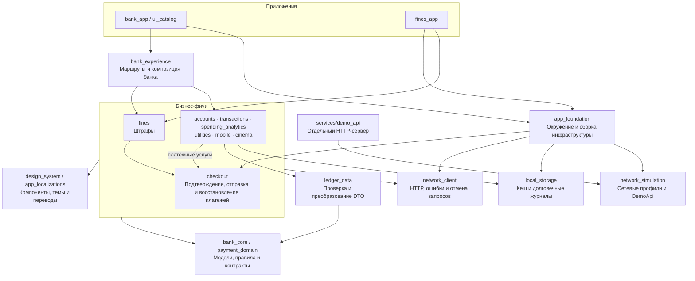

# DemoBank

DemoBank — индивидуальный демонстрационный проект банковского приложения на Flutter. Спроектировал и реализовал архитектуру, интерфейс, дизайн-систему, бизнес-сценарии и демонстрационный сервер, подготовил автоматические проверки и измерения производительности.

Проект включает витрину продуктов, управление счетами, историю операций, аналитику расходов, оплату штрафов, ЖКХ, мобильной связи и кино. Помимо банковского приложения реализованы самостоятельное приложение штрафов и UI-каталог. Все деньги и документы вымышлены; списания происходят только в демонстрационном процессинге.

## Отдельные приложения на общей кодовой базе

В моём опыте есть несколько кейсов, когда выделение фичи в моноприложение приносило на 1-2 порядка больше денег, чем та же фича в составе супераппа. Архитектура DemoBank рассчитана на выделение таких продуктов и разработку новых фич.

Оплата штрафов доступна в банковском приложении и в самостоятельных «Штрафах». Оба приложения используют тот же пакет фичи, общий платёжный сценарий и дизайн-систему. Самостоятельное приложение не подключает банковскую оболочку и остальные банковские фичи.

## Производительность

Реализованы анимации карточек, сворачиваемые заголовки и история из 12 000 операций с ленивым построением и ограниченным окном данных. На realme RMX3760 с экраном 60 Гц доля кадров сверх бюджета 16,7 мс в минутной контрольной прокрутке составила 0,25% в симуляции и 0,36% при HTTPS.

Условия и результаты измерений — в [отчёте проверок](docs/verification.md#физическая-производительность).

## Скорость разработки и единый интерфейс

Экраны собираются декларативно из компонентов и layout-примитивов общей дизайн-системы. Внутренние отступы, типографика, размеры и типовые интервалы централизованы: разработчику реже приходится задавать их вручную, а изменения общих компонентов распространяются на использующие их экраны.

В примере из сценария покупки билетов компоненты задают внутреннюю геометрию, а `DsColumn` — интервалы между ними:

```dart
DsColumn(
  children: [
    if (state.selectedSeats.isNotEmpty)
      DsPaymentSummary(
        title: l10n.cinemaYourChoice,
        amount: formats.money(state.total),
        details: [
          DsDetail(
            l10n.cinemaSeatsLabel,
            state.selectedSeats.map((seat) => seat.label).join(', '),
          ),
          DsDetail(
            l10n.commonFee,
            formats.money(Money(0, currency: state.total.currency)),
          ),
        ],
        notice: l10n.cinemaSeatsNotice,
      ),
    DsButton(
      label: l10n.cinemaToPayment,
      onPressed: state.selectedSeats.isEmpty || state.loading
          ? null
          : () => setState(
              () => _intent = _controller.intent(widget.accountId),
            ),
    ),
  ],
);
```

## Надёжность и работа с данными

Реализованы сценарии, в которых сервер мог выполнить платёж, но клиент не получил ответ. Приложение сохраняет контекст операции, различает ошибку и неизвестный результат, восстанавливает проверку после перезапуска.

Учтены гонки запросов: устаревший ответ не подменяет актуальный результат после изменения ввода или фильтра. История и аналитика согласуются по ревизиям данных; аналитические итоги рассчитываются независимо от загруженных страниц истории.

Для зависимостей, контроллеров и подписок определены владельцы и время жизни.

## Локализация

Поддержаны русский, английский и узбекский: тексты, отображение денег, дат, чисел и процентов, а также ввод денежных сумм. Язык выбирается в «Профиль → Язык» (по умолчанию — язык устройства), демо-сервер отвечает на нём же. В наборе счетов есть сумовый счёт (UZS) с собственной историей. Подробнее — [локализация](docs/localization.md), [ADR 0008](docs/adr/0008-localization.md).

## Запуск

Нужны Flutter **3.47.7**, Dart **3.13.5**, для Android — JDK 17 и Android SDK, для iOS — Xcode и iOS 15+. Версия Flutter записана в `.fvmrc`, зависимости зафиксированы в `pubspec.lock`.

```sh
fvm use 3.47.7
export PATH="$PWD/.fvm/flutter_sdk/bin:$PATH"
flutter pub get --enforce-lockfile
cd apps/bank_app
flutter run --dart-define=NETWORK_PROFILE=slow
```

Другие оболочки запускаются из `apps/fines_app` и `apps/ui_catalog`. Приоритет — качество и производительность мобильного Android. Готовый web-каталог остаётся необязательным инструментом разработки; web-поставка не входит в приёмку. Локальный режим работает без сервера и интернета: обычный Dio-клиент использует транспорт из `network_simulation`, а не задержки в виджетах. Профили: `normal`, `slow`, `unstable`, `offline`; воспроизводимый seed задаётся `--dart-define=NETWORK_SEED=42`.

В разделе «Профиль → Настройки демонстрации» доступны сеть, темы, уменьшение движения, сравнение перехода истории, очистка/старение кеша, новые операции и безопасный журнал запросов. Источник данных виден в настройках демонстрации. При HTTP-источнике профиль задаётся на сервере.

## Настоящий сетевой транспорт

Из корня:

```sh
dart run services/demo_api/bin/server.dart --port 8080 --profile slow --seed 42
```

Сервер принимает `--certificate PATH --private-key PATH` для TLS. Для сертификата нужен корректный hostname и доверенный центр; проверка сертификатов никогда не отключается. Приложение подключается через свою точку сборки:

```sh
cd apps/bank_app
flutter run --dart-define=DATA_SOURCE=http --dart-define=API_BASE_URL=https://YOUR_DEMO_HOST
```

Реальный HTTPS-прогон и локальная симуляция учитываются раздельно в [проверках](docs/verification.md). Для временного тестового адреса можно использовать [Cloudflare Quick Tunnel](https://developers.cloudflare.com/tunnel/get-started/quick-tunnels/), направленный только на demo API. Его адрес и доступность ограничены временем работы процесса.

Если повторное использование соединений на выбранном стенде приводит к зависанию ответов, доступна явная транспортная настройка `--dart-define=HTTP_KEEP_ALIVE=false`. По умолчанию используется пул соединений. Настройка передаётся через DI и записывается в диагностические и приёмочные отчёты; проверка TLS и платёжный контракт остаются штатными. Причина, цена дополнительных соединений и границы такого результата описаны в [ADR 0006](docs/adr/0006-http-connection-policy.md).

## Структура и правила

В проекте использована модульная слоистая архитектура по фичам — feature-first, с принципами Clean Architecture и ports-and-adapters.

- Фичи: счета, история, аналитика, штрафы и другие услуги выделены в пакеты.
- Слои: UI отображает данные, Cubit управляет сценарием, репозитории работают с API и кешем.
- Домен: модели, денежные правила и общие контракты отделены от Flutter, HTTP и SQLite.
- DI: зависимости передаются через конструкторы и собираются в оболочках приложений.
- Состояние UI: BLoC/Cubit с однонаправленным потоком данных.

Архитектура разделяет ответственности и зависимости, но не требует отдельного слоя или класса для каждого простого действия. Дополнительные механизмы вводятся там, где надо проверять корректность или упрощать реальные изменения.

Стрелки на схеме показывают зависимости пакетов. Блок бизнес-фич объединяет зависимости нескольких пакетов.



- `apps/` — три независимые точки входа и Android/web-конфигурации.
- `bank_experience` — композиция банка и каталога; самостоятельные «Штрафы» от неё не зависят.
- `app_foundation` — выбор транспорта, ленивый кеш, отдельный журнал восстановления платежей и настройки окружения.
- `bank_core`, `payment_domain` — предметные значения и узкие контракты без Flutter, Dio и SQLite.
- `ledger_data` — общий перевод банковских DTO и ключей кеша; предметные модели не знают JSON/API.
- `features/` — отображение, Cubit и реализация репозитория каждой фичи; переходы и зависимости передаются снаружи.
- `design_system` — семантические токены, темы, компоновка, инфографика и прерываемое движение.
- `network_client`, `network_simulation`, `local_storage` — инфраструктура; `services/demo_api` — сетевой сервер на том же контракте.

Архитектурный документ оформлен по arc42, с представлениями C4, обоснованием решений и ссылками на ADR.

См. [архитектуру](docs/architecture.md), [дизайн-систему](docs/design-system.md), [мотивацию анимации](docs/motion-design.md), [платежи](docs/payments.md), [требования](docs/requirements.md) и [результаты проверок](docs/verification.md).

## Проверки

Из корня:

```sh
dart format --output=none --set-exit-if-changed apps packages services tool test
flutter analyze --no-pub
dart run tool/quality_gate.dart
bash tool/run_tests.sh
python3 -m unittest discover -s tool/tests
```

AST-проверка запрещает визуальные литералы и обходы дизайн-системы в UI, импорты внутренних API соседних пакетов, циклы и лишние бизнес-фичи в транзитивных зависимостях standalone-приложения. Она также проверяется отрицательными тестами на числах, скрытых в константах/арифметике.

Python-тесты проверяют протокол release-отчёта и runner через синтетические логи и временный fake-adb: целостность, обязательный итог Flutter, ошибки, timeout и остановку только тестового пакета. Отдельные проверки коллектора Android защищают сверку APK, полноту COLD/HOT и route-измерений, выбор завершённого SurfaceFlinger-кадра и сохранение исходных показаний. Android SDK и устройство для этих тестов не нужны.

Сборки выполняются отдельно из папок приложений:

```sh
flutter build apk --release
```

Для каталога: `flutter build web --release --no-web-resources-cdn`. Команды Flutter для одного приложения запускаются последовательно, включая `drive` с готовым APK. Android release-команды здесь запускаются с pub/tooling refresh: ранее, на Flutter 3.35.7, `--no-pub` после интеграционных тестов оставлял dev-плагин в release-регистраторе. Сгенерированные Java-файлы вручную не редактируются.

Снимки эталонов лежат в `packages/design_system/test/goldens` и `packages/bank_experience/test/goldens`. При намеренном изменении внешнего вида запустите соответствующий `flutter test --update-goldens`, осмотрите PNG и выполните тесты повторно без обновления. Не утверждайте эталон только по успешной перезаписи.

## Физические замеры

[Методика и команды](docs/performance.md) отдельно описывают profile-измерение кадров, запуск release, память, медленную сеть и границы выводов. Debug/web и прохождение unit-тестов не доказывают скорость Android. Для обязательной проверки читаемости графиков и пользы движения подготовлена [пользовательская сессия](docs/user-acceptance.md).
