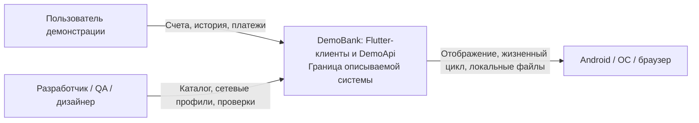
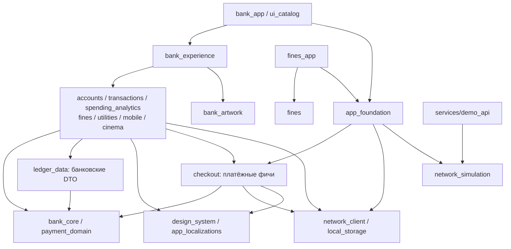
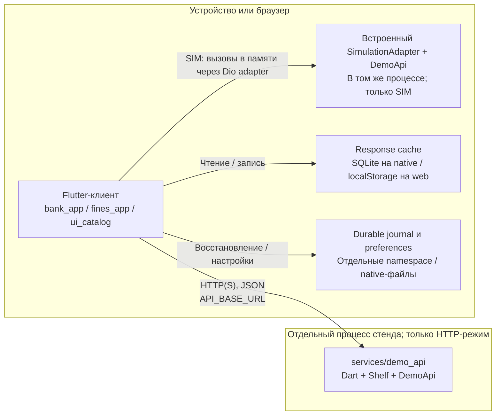

# Архитектура DemoBank

**18 октября 2026 года.** Документ описывает текущее рабочее дерево. Предложения по развитию — в §11.

Формат — 12 разделов [arc42](https://arc42.org/overview/), схемы — [C4](https://c4model.com/diagrams) и Mermaid, решения — [ADR](https://adr.github.io/). [ISO/IEC/IEEE 42010:2022](https://www.iso.org/standard/74393.html) используется как ориентир; полное соответствие стандарту не заявляется.

Продуктовые требования и бюджеты: [requirements.md](requirements.md). Результаты прогонов: [verification.md](verification.md). Запуск: [README](../README.md).

## 1. Цели

DemoBank — Flutter-монорепозиторий: банк со счетами, историей и аналитикой; четыре платежа — штрафы, ЖКХ, мобильная связь и кино; отдельное приложение штрафов; UI-каталог. Все деньги и документы синтетические. Приоритет — Android и работа при ненадёжной сети.

| Для кого | Что должна обеспечить архитектура |
| --- | --- |
| Пользователь | Понятный результат, восстановление после сбоя, сохранение позиции чтения |
| Разработчик | Изменение и выделение фич без переписывания оболочек |
| QA | Воспроизводимые задержки, ошибки и потеря ответа |
| Дизайнер | Общие темы, плотность, доступность и движение |
| Владелец продукта / архитектор | Переиспользование и понятная стоимость изменений |

Приоритеты качества: корректность операций, согласованность UI, отзывчивость, ограничение ресурсов, изменяемость и проверяемость.

## 2. Ограничения

- Flutter 3.35.7 / Dart 3.9.2, общий Pub Workspace и lockfile. Пакеты проверяются совместно; независимые релизы не организованы.
- Локальный режим работает без интернета. Симуляция находится под Dio; экраны не имитируют сетевой успех.
- Банк и самостоятельные штрафы используют общие фичу и дизайн-систему. Инфраструктура не зависит от банковской композиции.
- Поддерживаются ru/en/uz и несколько валют. Web-каталог вспомогательный; его проверки не подтверждают Android.
- DemoApi рассчитан на демонстрацию, без гарантий многопользовательской изоляции, высокой доступности и промышленного процессинга.

Демо-календарь `DemoApi.businessNow` — 16.10.2026, 15:00 МСК. Он задаёт отчётные периоды и даты новых операций. Реальное время определяет срок действия платёжных условий. Для настоящего банка нужен отдельный календарный контракт.

## 3. Контекст



В систему входят клиенты, общие пакеты и встроенный либо отдельный DemoApi. Банковская авторизация, KYC, внешний процессинг и реальные расчёты не реализованы. Витрина, корзина, QR-сценарии и настройки услуг не создают внешние заказы и не подключают реальные карты.

Внешний интерфейс — HTTP(S)/JSON; `Accept-Language` задаёт язык содержимого. HTTP 200 сам по себе не подтверждает корректность денежного результата.

Представления отвечают на разные вопросы: контекст (§3) — границы продукта; структура (§5) — ответственность и импорты; выполнение (§6) — успех, сбой и повтор; развёртывание (§7) — процессы и данные; решения и качество (§8–11) — причины, проверки и риски.

## 4. Архитектурный подход

Код сгруппирован по бизнес-возможностям. Внутри фичи разделены view, Cubit и репозиторий. Предметные значения и общие банковские/платёжные порты вынесены в Dart-пакеты без Flutter.

Cubit зависит от узкого контракта, API-адаптер переводит JSON, оболочка выбирает реализации. Это практическое применение Clean Architecture и ports-and-adapters. View и API-репозиторий могут находиться в одном feature-пакете; контракты поиска услуг — рядом с фичей. Отдельный use case-класс для каждого вызова не создаётся.

## 5. Структура

### Пакеты

| Пакет / каталог | Ответственность |
| --- | --- |
| `apps/bank_app`, `apps/fines_app`, `apps/ui_catalog` | Точки входа и платформенная конфигурация |
| `packages/bank_experience` | Маршруты банка, сборка фич, витрина и межэкранные сигналы |
| `packages/app_foundation` | Окружение, транспорт, хранилища, настройки и диагностика |
| `packages/features/*` | Сценарий, view, Cubit, контракт данных и API-репозиторий |
| `packages/bank_core` | `Money`, ledger, фильтры, счета, профили и банковские порты |
| `packages/payment_domain` | Intent, quote, record, ошибки и платёжные порты |
| `packages/ledger_data` | Проверка банковских DTO и кодирование фильтров |
| `packages/checkout` | Общие подтверждение, отправка, результат и восстановление платежа |
| `packages/network_client` | Dio, тайм-ауты, отмена, типизированные ошибки и безопасные события |
| `packages/network_simulation` | Поток ответа, задержки, сбои и синтетический DemoApi |
| `packages/local_storage` | CacheStore, Drift/SQLite, web-адаптер и память для тестов |
| `packages/design_system` | Темы, токены, layout, компоненты, семантика и движение |
| `packages/app_localizations`, `packages/bank_artwork` | Продуктовые переводы и ресурсы витрины |
| `services/demo_api` | Shelf HTTP(S)-оболочка над DemoApi |
| `tool`, `.github/workflows` | Проверки, runner-ы и сборки |

### Зависимости



Стрелка означает импорт, не сетевой вызов. Диаграмма объединяет зависимости нескольких фич; точный граф задают `pubspec.yaml` и исходники.

Фичи не импортируют друг друга: навигация и данные передаются через оболочку, callbacks и доменные фильтры. Домен не зависит от Flutter, HTTP и SQLite. Самостоятельные штрафы не включают `bank_experience`, `bank_artwork` и другие банковские фичи. Бизнес-правила не размещаются в точках входа, транспорте и дизайн-системе; checkout не занимается поиском услуг.

### Композиция и время жизни

`main` создаёт окружение и восстанавливает язык до первого кадра. `AppEnvironment` собирает инфраструктуру; `BankExperience` — репозитории, контроллеры и GoRouter; `FinesApplication` — отдельную фичу. Зависимости передаются через конструкторы, глобального service locator нет.

| Владелец | Ресурсы и освобождение |
| --- | --- |
| `AppEnvironment` | ApiClient, response cache, durable journal, preferences; принимает владение внедрёнными хранилищами, закрывает их в `dispose` |
| Оболочка | Закрывает созданное ею окружение; за внешнее отвечает вызывающий |
| `BankExperience` | Router, accounts/history/overview Cubit и сигналы живут вместе с банком |
| Экран | Закрывает собственные Cubit, подписки и контроллеры в `dispose` |
| `CheckoutCubit` и app-scoped pending store | Контроллер живёт с экраном; запись восстановления переживает экран и процесс с ограничением web из §7 |
| Компонент движения | Удерживает контроллеры смонтированных строк |

Создание графа не ждёт сети; SQLite открывается лениво. Чтение предпочтений выполняется отдельно перед UI. Тест завершает жизненный цикл переданного окружения явно.

## 6. Основные сценарии

### Чтение и ошибка сервера

Экран вызывает Cubit, тот — reader. Сохранённая копия может отображаться до ответа сети. Репозиторий проверяет DTO и валюту до кеширования. `writeResponse` регистрирует сбой записи кеша, но возвращает серверный результат. Повреждённый кеш считается промахом; ошибка чтения не блокирует сеть.

При сетевом сбое пригодные старые данные остаются на экране с ошибкой и действием повтора; признаки `failed`/`stale` зависят от фичи. История и аналитика отдельно сохраняют неудавшийся фильтр: «Повторить» запрашивает его, двойное нажатие не создаёт второй запрос. Подробности — [ADR 0009](adr/0009-failure-and-recovery-boundaries.md).

### Изменение ввода и история

Редактирование документа в штрафах или лицевого счёта в ЖКХ сбрасывает начисления и выбор. Ответ прежнего поколения игнорируется. Оплата требует нового поиска и выбора.

История использует `revision`, стабильные ID и непрозрачные курсоры. Страница содержит 30 записей; стандартный предел — пять полных страниц, примерно 150 моделей. Метаданные посещённых слотов этим пределом не ограничены. Разные revision не смешиваются.

При обновлении загружается окно вокруг ID читаемой строки. Фоновые изменения во время чтения применяются явно. Аналитика получает полные агрегаты отдельным запросом; фильтр и revision передаются в детализацию. Суммирование загруженных страниц не заменяет агрегат. Epoch/generation защищает состояние от старого ответа, но не отменяет сам HTTP-запрос.

### Оплата услуги

```mermaid
sequenceDiagram
  actor U as Пользователь
  participant F as Фича услуги
  participant C as CheckoutCubit
  participant J as Durable pending store
  participant A as PaymentGateway / DemoApi
  U->>F: Выбор начисления или реквизитов
  F->>C: begin(intent)
  C->>J: load()
  alt Есть незавершённая операция
    C->>A: status(сохранённый ключ)
  else Журнал пуст
    C->>A: quote(intent)
    A-->>C: Сумма, комиссия, срок условий
    C-->>U: Экран проверки
    U->>C: Подтвердить
    C->>J: reserve(ключ и условия)
    J-->>C: Запись сохранена
    C->>A: submit(quoteId, тот же ключ)
    alt Ответ получен
      A-->>C: PaymentRecord
      C->>C: Сверить ключ, quote, сумму и валюту
    else Ответ потерян
      C->>A: status(тот же ключ)
    end
  end
  Note over C,J: Подтверждённый финальный результат допускает очистку журнала.
  Note over C,U: pending / uncertain сохраняют возможность проверки; успех не угадывается.
```

До отправки сохраняется pending-запись. Если запись завершается ошибкой, отправки нет. Резервация сериализована в app-scoped store: две формы не могут заменить незавершённый платёж. Ответ сверяется с сохранённой операцией. Неопределённый исход сохраняет ключ; повтор отправки требует явного действия. Сбой очистки после принятого checkout-результата оставляет запись для повторной сверки.

Это не гарантия распределённого exactly-once исполнения: в настоящем backend идемпотентность и атомарность списания обеспечивает сервер с постоянным хранилищем. На web pending-запись может остаться только в памяти сессии (§7).

### Операция со счётом

Пополнение и переводы используют `AccountOperationCubit` и `AccountOperationJournal`: у них нет платёжного quote/status-процесса услуги. Журнал допускает одну незавершённую операцию **на счёт**. Перед очисткой проверяются непустой ID результата, `requestId`, сумма и валюта.

Потерянный или несогласованный ответ сохраняет прежний ключ и неопределённый результат. Серверный отказ позволяет исправить ввод после успешной очистки журнала. Сбой очистки после ответа операции со счётом оставляет `resultUnknown`; у checkout уже подтверждённый результат при таком сбое сохраняется.

Восстановление перевода не зависит от справочника получателей. Его недоступность при новом переводе имеет отдельную ошибку и повтор загрузки, не считается повреждением журнала.

## 7. Развёртывание



SIM и HTTP — альтернативные режимы. Встроенный DemoApi работает в процессе клиента. В терминологии C4 контейнер — исполняемая единица или хранилище, не Docker; встроенный DemoApi не является отдельным контейнером.

| Режим | Источник данных и хранение |
| --- | --- |
| SIM | Встроенный DemoApi без интернета; изменения сохраняются через app journal |
| HTTP(S) | Отдельный DemoApi; CLI-сервер хранит состояние в памяти, перезапуск не гарантирует сохранность результатов |
| Native | Drift/SQLite, ленивое открытие и SQL в фоновом isolate |
| Web | localStorage; при отказе возможен fallback в память сессии без гарантии сохранности после закрытия браузера |

Response cache и journal разделены по режиму и seed/адресу backend, кеш ответов — дополнительно по языку. Preferences хранятся отдельно. Scope разделяет окружения, но не обеспечивает авторизацию и изоляцию пользователей.

TLS завершается на сервере или доверенном стенде; проверка сертификатов клиента не отключается. `HTTP_KEEP_ALIVE` по умолчанию `true`; `false` предусмотрен для исследованного HTTPS-сбоя и требует дополнительных соединений — [ADR 0006](adr/0006-http-connection-policy.md).

[CI](../.github/workflows/ci.yml) проверяет генерацию переводов, форматирование, анализатор, архитектуру, тесты и сборки двух APK и web-каталога. Промышленное развёртывание и публикация в магазинах этим не выполняются.

## 8. Общие правила

| Область | Правило |
| --- | --- |
| Деньги | `Money` — целые минорные единицы и валюта. Сложение разных валют запрещено; остатки показываются раздельно, форматирование выполняет UI |
| Данные | `ledger_data` проверяет банковские DTO до кеширования. DTO услуг разбираются в своих репозиториях; полнота валидации проверяется контрактными тестами |
| Платёж | Начисления, комиссия, доступность мест и окончательный статус определяются сервером. Кеш и локальный UI не подтверждают списание — [payments.md](payments.md) |
| Response cache | До 120 записей LRU, до 1 МиБ на запись, стандартный TTL — пять минут. Истечение срока не удаляет копию; она пригодна для начального показа с обновлением |
| Журнал | `durable` не участвует в LRU и не удаляет повреждённую pending-запись молча. Checkout допускает карантин только после явного подтверждения пользователя |
| Состояние SIM | Повреждённый `simulator_state` разрешено заменить fixtures. Это исключение не относится к pending journal |
| Ошибки | `ApiClient` → `ApiFailure`, платёжный адаптер → `PaymentFailure`. Cubit возвращает код, экран — текст. Отказ сервера, отмена, timeout и неизвестный исход различаются |
| Повторы и отмена | Денежные POST автоматически не повторяются. Контроллеры проверяют поколение запроса и закрытие; `RequestCancellation` используется не всеми reader-ами |
| Диагностика | `ErrorSink` различает ожидаемые отказы и дефекты. По умолчанию журнал локальный, внешний crash-reporting не подключён |
| UI | Темы, геометрия, варианты и движение задаются в `design_system`. AST gate проверяет запрещённые конструкторы и литералы, включая выражения; см. [design-system.md](design-system.md), [motion-design.md](motion-design.md) |
| Язык | `app_localizations` — ru/en/uz; серверные тексты следуют `Accept-Language`. Смена языка обновляет содержимое и выбирает свой кеш. `DsLocalizations` не зависит от продуктового каталога — [ADR 0008](adr/0008-localization.md) |

SOLID применяется к границам: Single Responsibility разделяет view/Cubit/mapper/transport/журнал; Open/Closed допускает замену HttpClientAdapter и PaymentGateway; Liskov Substitution проверяется общими контрактами; Interface Segregation — узкими readers/gateway/store/clock/key factory; Dependency Inversion — зависимостью координатора от порта. Проверки: ревью, unit/widget/contract tests, компиляция API и граф импортов. Обязательства DI-01…DI-07, SOL-01…SOL-05 и BP-01…BP-04 заданы в требованиях.

## 9. Решения: причины и компромиссы

Альтернативы ниже — сопоставление вариантов, не результаты экспериментов. Измеренные основания указаны в соответствующих ADR.

| Решение | Преимущество | Цена и пересмотр |
| --- | --- | --- |
| [Явная композиция](adr/0001-explicit-composition.md) | Независимые оболочки и тестовые графы; видимые зависимости | Root растёт. Service locator / генерацию DI пересмотреть при ошибках ручной сборки и росте графа |
| Пакеты по фичам | Сценарий можно изменять и выделять отдельно | Нужна дисциплина API. Глобальные каталоги view/repository размывают границы; дополнительные пакеты оправданы отдельной ответственностью |
| Cubit + immutable state | Логика запросов и форм проверяется без layout | Гонки обрабатываются явно; BLoC с событиями нужен при усложнении потоков |
| [Snapshot-пагинация](adr/0002-snapshot-pages.md) | Согласованный набор и сохранение позиции при ограничении моделей | Нужны версии, курсоры и обработка истечения revision; offset изменяемого списка допускает пропуски и дубли |
| [Семантическая DS](adr/0003-semantic-design-system.md) | Темы, адаптивность и доступность исправляются централизованно | Новый вариант требует поддержки общего API; экранные настройки расходятся между приложениями |
| [Общий checkout](adr/0004-durable-demo-checkout.md) | Одни правила восстановления для четырёх услуг | Изменение затрагивает все услуги; отдельные копии множат денежные дефекты |
| [Разные гарантии хранения](adr/0009-failure-and-recovery-boundaries.md) | Кеш не скрывает серверный успех, журнал обязателен перед отправкой | Ни подавление всех ошибок, ни фатальность каждого сбоя хранения не подходят |
| Dio + общий DemoApi | Одна сериализация и воспроизводимые сбои в SIM/HTTP | Общая ошибка может проявиться в обоих режимах; UI-моков недостаточно, нужны независимые контракты |
| Drift/SQLite за CacheStore | Фоновый SQL, транзакции и восстановление после процесса | Требуется явная политика долговечности; память годится для тестов, но теряется при закрытии |
| [Общий каталог переводов](adr/0008-localization.md) | Согласованные термины и форматирование | Штрафы включают строки других фич; разделять при независимых командах/релизах |
| [HTTP-соединения](adr/0006-http-connection-policy.md) | Явный режим для исследованного сбоя стенда | Дополнительные соединения при закрытии; default не менять без измерений |
| [Android renderer](adr/0007-android-renderer.md) | Явный Skia для закреплённого SDK и проверенного устройства | Преимущество над Impeller не универсально; пересмотреть при обновлении Flutter/GPU |
| [Уровни доказательств](adr/0005-evidence.md) | Тесты, TLS, устройство и пользовательская приёмка оцениваются отдельно | Зелёный CI не закрывает непроверенные свойства |

## 10. Проверки качества

| ID | Сценарий и ожидаемый результат | Проверка |
| --- | --- | --- |
| Q-A1 / Q-A2 | Сбой записи кеша не отменяет серверный результат; повреждённый профиль не блокирует сеть | [cache_failures_test.dart](../packages/bank_experience/test/cache_failures_test.dart), [local_storage](../packages/local_storage/test/cache_store_test.dart) |
| Q-A3 / Q-A4 | Потеря ответа сохраняет ключ; чужой результат не объявляется успехом и не очищает журнал | [checkout_cubit_test.dart](../packages/checkout/test/checkout_cubit_test.dart), [account_operation_test.dart](../packages/features/accounts/test/account_operation_test.dart) |
| Q-A5 | Изменение номера сбрасывает результаты и исключает ответ прежнего запроса | Тесты Cubit и widget flow [штрафов](../packages/features/fines/test/fines_cubit_test.dart), [ЖКХ](../packages/features/utilities/test/utilities_cubit_test.dart) |
| Q-A6 | Повтор использует неудавшийся фильтр, сохраняя согласованность старых данных | [history_cubit_test.dart](../packages/features/transactions/test/history_cubit_test.dart), [analytics_test.dart](../packages/features/spending_analytics/test/analytics_test.dart) |
| Q-A7 | Новые строки не заменяют читаемый участок до готовности окна, якорь сохраняется | Тесты истории/движения и [device-сценарии](performance.md) |
| Q-A8 | Недопустимая зависимость или визуальный литерал отклоняются | [quality_gate.dart](../tool/quality_gate.dart), [quality_gate_test.dart](../test/quality_gate_test.dart) |
| Q-A9 | Смена языка согласует UI и серверные тексты, не подмешивая чужой кеш | [localization_test.dart](../packages/bank_experience/test/localization_test.dart), CI-сверка ARB |
| Q-A10 | Маршрут на физическом Android укладывается в бюджеты кадров и памяти | PERF-01…PERF-07, [performance.md](performance.md) |

Цели для 60 Гц: UI/raster — примерно 16,7 мс; p95 первого кадра перехода — 100 мс; кадров выше бюджета за контрольную минуту — менее 1%. Результат требует версии исходников/APK, устройства, источника данных и условий. Старый замер не подтверждает новую сборку.

Тесты покрывают темы, узкую ширину, крупный текст, семантику и уменьшенное движение. [Пользовательская приёмка](user-acceptance.md) DS-23/DS-24, AN-16 и MOT-11/MOT-12 остаётся открытой: визуальное направление, понятность аналитики и польза движения требуют оценки пользователя.

## 11. Риски и развитие

| Ограничение | Последствие / следующее действие |
| --- | --- |
| HTTP DemoApi: память одного процесса, без промышленной авторизации и постоянной БД | Для реальных денег нужны отдельный backend, auth/authz, постоянный ledger, транзакции, аудит и серверная идемпотентность |
| Общий DemoApi для SIM/HTTP | Сохранять независимые ожидаемые результаты и проверки неверных ответов |
| Запросы отменяются не везде | При подтверждённой нагрузке применять RequestCancellation и объединять одинаковые чтения без отмены чужого потребителя |
| ID/даты истории и `HistoryState.slots` растут с сессией | Измерить стоимость, затем ограничивать или переиспользовать метаданные и проекции |
| Web fallback и отсутствие заявленного шифрования БД | Перед реальными персональными данными определить модель угроз, хранение ключей и требования платформы |
| Валидация DTO услуг унифицирована не полностью | Неверный ответ может стать общей ошибкой; расширять строгий маппинг и отрицательные контрактные тесты |
| Банковская оболочка включает продуктовые экраны | Выделять пакет при втором потребителе или отдельной ответственности |
| Scope не включает реального пользователя | До авторизации определить user scope, logout/login, миграцию и судьбу незавершённых операций |

Рекомендация: поддерживать этот файл как карту системы, а решения с последствиями — как ADR. Изменение границы пакета, журнала или платёжного протокола связывать в PR с ADR и тестом инварианта. Дополнительные DI/use case-слои и сервисы вводить по подтверждённой необходимости. Замена URL недостаточна для настоящего банка: отдельно проектируются backend, безопасность, ledger и миграция журналов.

Новую фичу добавлять через контракт, репозиторий, Cubit и DS-экран; проверить, нет ли готовой реализации. Серверные изменения сопровождать тестами успеха, отказа, неверного ответа и неопределённого исхода. Реализации и маршруты подключать в composition root. Для отдельного приложения задать бренд и platform identity, проверить dependency closure, добавить сборку в CI и обновить документы. Образец — `apps/fines_app`.

## 12. Термины

| Термин | Значение |
| --- | --- |
| Composition root | Выбор реализаций и связывание зависимостей |
| Порт / адаптер | Контракт / реализация транспорта или хранения |
| Feature | Бизнес-сценарий с экраном, состоянием и контрактом данных |
| Intent / quote | Намерение оплатить / серверные условия с ограниченным сроком |
| Idempotency key / requestId | Ключ повторения той же операции |
| Pending journal / response cache | Обязательная запись восстановления / необязательная копия ответа |
| Revision / snapshot | Версия согласованного набора / его состояние |
| Cursor / anchor | Серверный указатель страницы / стабильный ID для сохранения чтения |
| Epoch / generation | Номер актуального запроса |
| Uncertain / resultUnknown | Итог неизвестен; возможность проверки сохраняется |
| ADR | Контекст, решение, причины, последствия и условия пересмотра |
| SIM / HTTP | Встроенный транспорт / сетевое соединение с demo backend |
