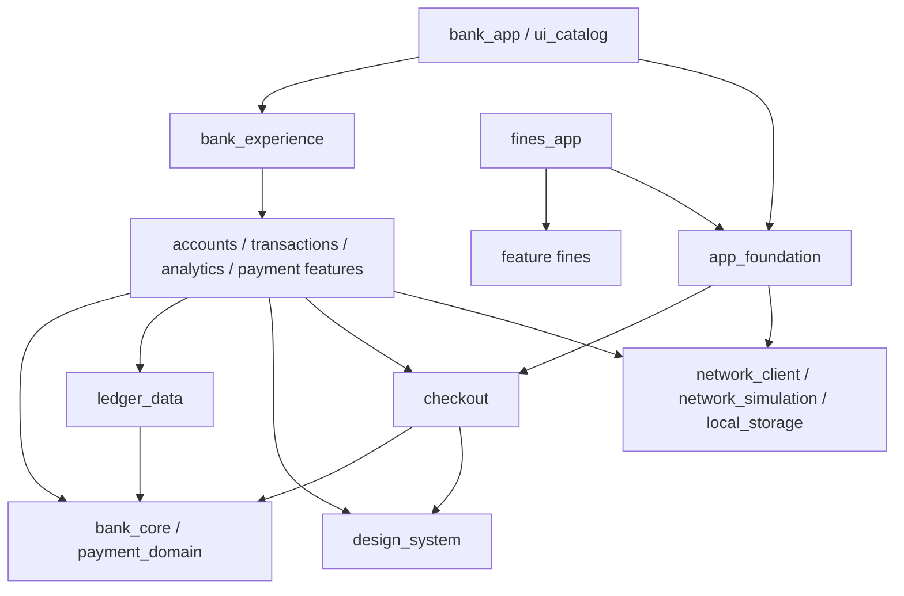

# Архитектура и расширение

## Направление зависимостей

Domain определяет ценности и узкие контракты: `AccountsReader`, `HistoryReader`, `AnalyticsReader`, `PaymentGateway`, `PendingPaymentStore`, clock и генератор ключей. Cubit координирует запросы и состояния через эти интерфейсы. Конкретные API-репозитории переводят DTO в предметные модели и согласуют кеш. UI показывает immutable-состояние; пользовательские намерения идут к Cubit/контроллеру. Виджет не создаёт HTTP-клиент и не рассчитывает правила платежа.

Общий `bank_core` содержит только читаемые банковские значения. Feature-пакеты не импортируют друг друга; стандартное открытие операции/аналитической детализации передаётся callback-контрактом через оболочку. Общая инфраструктура не импортирует `bank_experience` и другие бизнес-фичи.

## Области жизни и DI

| Область | Владелец | Создание и освобождение |
|---|---|---|
| Приложение | BankExperience / FinesApplication | Создают AppEnvironment при отсутствии внедрённого; освобождают только собственное окружение |
| Инфраструктура | AppEnvironment | Один ApiClient, транспорт и checkout dependencies; SQLite открывается лениво в отдельном isolate; `dispose` закрывает ресурсы однократно |
| Банк | BankExperience | AccountsCubit, HistoryCubit, API readers, router; освобождаются вместе с оболочкой |
| Экран | AnalyticsPage / HistoryScreen / drill | Собственный Cubit и ScrollController; закрытие в dispose; ответы после закрытия игнорируются |
| Платёжный сценарий | CheckoutPage / feature | Контроллер шага; долговременный pending journal переживает закрытие экрана и процесса |
| Видимая строка | DsAnimatedSliverList | Контроллер только для смонтированной строки; удаляется после ухода/размонтирования |

Конструкторы являются DI-механизмом. Глобальный service locator и отдельная библиотека DI не нужны: граф небольшой, статически проверяется компилятором, окружения тестов можно создавать независимо. Выбор реализации находится в composition root, а не в бизнес-классе. `AppEnvironment` принимает подменные cache/journal/SimulationAdapter; shell принимает целое окружение. Успех/ошибка первого чтения представлены состоянием экрана, а создание графа не ждёт сеть или БД.

`AppEnvironment` принимает владение переданными ему инфраструктурными ресурсами. Если окружение передано в shell, его жизненным циклом управляет вызывающий. Два окружения не разделяют регистрации, транспорт или тестовое состояние.

Кеш ответов и журнал платежей имеют разные базы и namespace источника/seed/backend URL. Очистка кеша не удаляет данные восстановления платежа. Кеш ответов — только ускорение: нераспознаваемая запись удаляется и считается промахом, а ошибка чтения кеша никогда не отменяет сетевой запрос. Журнал создаётся как `durable`: без LRU-вытеснения и без молчаливого удаления повреждённых записей.

Демо-календарь задаёт `DemoApi.businessNow` (16.10.2026, 15:00 МСК). От него оболочка считает отчётные периоды, им же датируются операции, созданные во время работы. Поэтому новые платежи попадают в «текущий месяц» независимо от системных часов устройства. Срок действия quote по-прежнему проверяется по реальному времени. Перезапуск с другим источником не использует чужой pending-платёж. Общий HTTP API не содержит платёжных реквизитов в диагностике.

Политика HTTP-соединений задаётся при создании `ApiClient`. `HTTP_KEEP_ALIVE=false` выбирает совместимость с проверенным проблемным HTTPS-стендом; обычное значение — `true`. Фичи получают прежние контракты и не знают эту настройку. Фактическое значение входит в диагностические и приёмочные отчёты. Решение и ограничения доказательств описаны в [ADR 0006](adr/0006-http-connection-policy.md).

## SOLID на реальных границах

| Принцип | Реализация | Проверка |
|---|---|---|
| S | Отдельные view, state coordinator, repository, transport, payment rule | Ревью; unit/widget/contract tests по поведению |
| O | Новый транспорт — Dio HttpClientAdapter; новый поставщик — feature + quote intent | Существующий checkout не знает поставщика; локальный/HTTP контракт |
| L | SimulationAdapter и настоящий транспорт возвращают одинаковые данные, ошибки и серверные статусы | Общие HTTP/TLS/fixture проверки, timeout/cancel/lostresponse/idempotency |
| I | Раздельные readers и PaymentGateway; фича получает только необходимое | Компиляция публичного API, standalone fines dependency closure |
| D | Управление состоянием зависит от domain interfaces; реализации передаются shell | Тесты с управляемыми fake readers и независимыми окружениями |

Архитектурный AST gate проверяет технические границы, но ответственность классов и полезность абстракций подтверждаются ревью. Не добавляются use case-обёртки, которые лишь переименовывают один вызов репозитория. Checkout выделен потому, что координирует долговременную идемпотентную операцию и используется четырьмя поставщиками.

## История и аналитика

История использует snapshot revision, стабильные ID и серверные курсоры, 30 записей в странице. В Cubit находится не более пяти полных страниц (150 моделей); лёгкие ID/даты сохраняют адресацию уже посещённых слотов. После вытеснения обратная прокрутка снова получает окно в той же revision. При обновлении сервер может найти окно вокруг стабильной видимой операции: это сохраняет далёкую позицию, не скачивая всю историю. Данные разных revision не смешиваются.

Аналитика получает полные агрегаты отдельным компактным запросом, не суммирует видимые страницы. Фильтр и revision переходят в историю детализации через публичный domain-контракт. После платежа оболочка посылает сигнал обновления; выбранный период и пригодный старый результат сохраняются до согласованного нового ответа. Latest-request-wins исключает устаревшие ответы.

## Добавить фичу и выделить приложение

1. Создайте пакет `packages/features/name` с публичным barrel-файлом. Опишите предметный контракт и типы результата без Flutter/HTTP, если это новая бизнес-граница.
2. Реализуйте API-маппинг/репозиторий, immutable-состояние и экран на семантических компонентах DS. Передайте checkout и callbacks через конструктор.
3. Добавьте маршруты API и согласованные fixture-данные в demo backend. Пройдите одинаковые контрактные проверки реального и локального транспорта.
4. Подключите фичу в composition root банка. Для отдельного приложения создайте оболочку, зависящую только от этой фичи и общей инфраструктуры.
5. Настройте `DsBrand`, имя и applicationId оболочки. Код сценария и дизайн-компонентов остаётся тем же.
6. Добавьте standalone package в правило dependency closure `tool/quality_gate.dart`, сборку и journey в CI.

`apps/fines_app` является работающим примером этой процедуры. Она не зависит от `bank_experience`, accounts, transactions, analytics, utilities, mobile или cinema.

## Референсные экраны и операции со счётом

`bank_core` содержит неизменяемые `AccountProfile`, `AccountOperation`, точные `Money`, порты `AccountManagement` и `AccountOperationJournal`. `ledger_data` отображает DTO без Flutter. Фича `accounts` владеет API-адаптером, Cubit, журналом и `AccountDashboard`; маршруты и жизненный цикл ресурсов связывает `bank_experience`. Внешние зависимости передаются через конструкторы, скрытого service locator нет.

В составе банка пять синтетических счетов: основной/накопительный RUB, USD, GBP и бизнес-счёт RUB. Валюты не суммируются. Доступный остаток учитывает ожидающие платежи; пополнение, перевод своим счетам, перевод учебному контакту и оплата услуг согласованы с общими счетами и ledger. Из счёта в историю/аналитику передаётся фильтр, в платёж — идентификатор выбранного счёта. Название счёта для подтверждения внедряется resolver-ом общей checkout-композиции.

Операция со счётом сохраняет ключ и сумму до отправки. Одна последовательная резервация на счёт предотвращает замену незавершённого запроса второй формой. Потерянный ответ и перезапуск восстанавливают тот же ключ; подтверждённая серверная валидация позволяет исправить ввод. Повреждённый журнал блокирует новую отправку. Кеш и журналы разделены существующим scope источника/seed. GET, POST и ошибки проходят общий transport pipeline; UI не подменяет сетевые данные таймером.

Длинная домашняя витрина и 20 собственных изображений живут в необязательной композиции банка. `bank_artwork` — отдельная зависимость банка и каталога; standalone fines сохраняет только общую DS и свою фичу. Все четыре платёжные фичи по-прежнему не зависят от приложения банка. Демонстрационные предложения и корзина имеют локальное состояние без внешних заказов; настройки автопополнения и округления сохраняют учебные правила, без подключения настоящей внешней карты.
