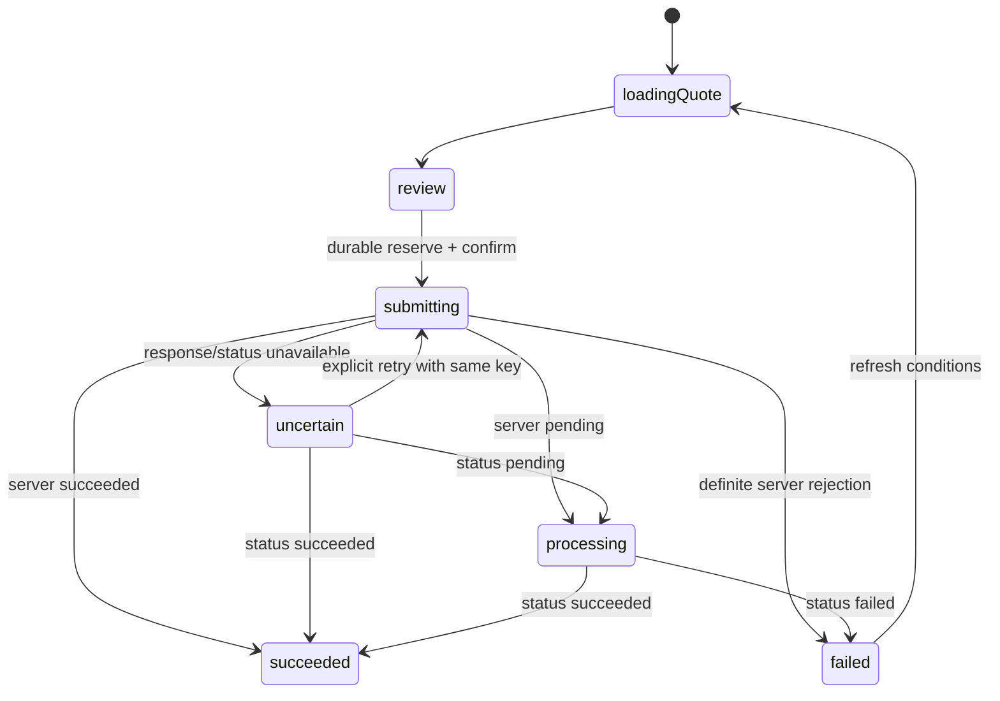

# Платёжные фичи и общий checkout

`payment_domain` содержит предметные модели и порты без Flutter, HTTP и базы данных. `checkout` реализует координатор состояний, адаптер API, восстановление журнала и общий экран подтверждения/результата. Каждый пакет услуги отвечает за собственный поиск, выбор и проверку реквизитов.

## Сборка и публичные контракты

| Пакет | Публичный экран | Контракт данных | Адаптер |
| --- | --- | --- | --- |
| `fines` | `FinesFeature` | `FinesRepository` | `ApiFinesRepository` |
| `utilities` | `UtilitiesFeature` | `UtilitiesRepository` | `ApiUtilitiesRepository` |
| `mobile` | `MobileFeature` | `MobileRepository` | `ApiMobileRepository` |
| `cinema` | `CinemaFeature` | `CinemaRepository` | `ApiCinemaRepository` |

Все экраны получают `repository`, `CheckoutDependencies`, `accountId` и необязательный `onPaymentChanged`. Зависимости передаются через конструкторы. Фичи не извлекают глобальные сервисы, не создают HTTP-клиенты и не импортируют оболочки приложений или соседние бизнес-фичи.

`CheckoutDependencies` собирается в приложении из `PaymentGateway`, `PendingPaymentStore`, `PaymentClock` и `IdempotencyKeyFactory`. В приложении используются `ApiPaymentGateway`, `CallbackPendingPaymentStore`, `SystemPaymentClock` и `SecureIdempotencyKeyFactory`. Клиент и журнал имеют область жизни приложения, Cubit и контроллеры полей — область жизни экрана. Экран освобождает собственные контроллеры; HTTP-клиент и база освобождаются их владельцем в оболочке.

`CallbackPendingPaymentStore` получает асинхронные `read`/`write` для одной долговечной записи. В приложении запись связывается с локальной базой; `MemoryPendingPaymentStore` предназначен для тестов. Хранение находится за портом: checkout не зависит от конкретного движка БД. Журнал и серверное состояние привязаны к выбранному источнику данных, чтобы локальный платёж не восстанавливался в другом серверном окружении.

Самостоятельные «Штрафы» подключают эти же пакеты `fines`, `checkout`, `payment_domain`, `bank_core`, `design_system` и инфраструктуру. Пакеты ЖКХ, связи, кино, истории и аналитики для сценария штрафов не нужны.

## Завершённые сценарии

- Штрафы: документ → список начислений → основание, УИН, срок и сумма → серверные условия → подтверждение → квитанция. Оплаченное начисление остаётся видимым и недоступно для повторной оплаты.
- ЖКХ: лицевой счёт → счета поставщиков → выбор нескольких неоплаченных счетов → общая сумма и комиссия → подтверждение → квитанция. После возврата обновляется статус счетов.
- Связь: номер → определение оператора → возможность уточнить оператора → сумма в рублях с точностью до копейки → подтверждение → результат. Допустимая сумма — 100–15 000 ₽.
- Кино: фильм → сеанс → свободные места → сумма → подтверждение → билет с сеансом и местами. Занятые места недоступны для выбора. Конфликт между получением условий и подтверждением приводит к обновлению доступности и новому явному выбору.

Первичная загрузка, пустой ответ, ошибка и повтор представлены явно. Запросы фич имеют номер поколения: ответ более раннего поиска или выбора не подменяет текущие данные. После закрытия Cubit результаты не публикуются. Задержки, скорость передачи и ошибки задаются транспортом; в UI нет искусственных пауз или ветвлений по режиму сети.

## Денежные и сетевые инварианты

Суммы и комиссии хранятся в целых минимальных единицах валюты. Ввод `155,55` преобразуется в `15555` копеек разбором десятичной строки, без `double`. Несовпадающие валюты, неположительная сумма и отрицательная комиссия не образуют корректное предложение оплаты. DTO преобразуются в предметные модели на границе адаптеров.

Для начислений передаются идентификаторы и версии; для кино — сеанс, места и версия доступности. Сумму пересчитывает сервер. Изменение цены, доступности или статуса после загрузки не обходится локальной суммой. Условия ограничены сроком действия; сервер повторно проверяет их при подтверждении.

API:

| Действие | Метод и путь |
| --- | --- |
| Поиск штрафов | `GET /services/fines?document=…` |
| Начисления ЖКХ | `GET /services/utilities?account=…` |
| Операторы связи | `GET /services/operators?phone=…` |
| Афиша, сеансы, места | `GET /services/movies`, `/services/sessions?movieId=…`, `/services/seats?sessionId=…` |
| Предложение оплаты | `POST /checkout/quotes` |
| Подтверждение | `POST /checkout/payments` |
| Восстановление | `GET /checkout/payments/status?idempotencyKey=…` |

HTTP и локальный симулятор используют один `ApiClient`, сериализацию, адаптеры репозиториев и управление состоянием. Серверные коды `bill_stale`, `seat_conflict` и `quote_expired` преобразуются в типизированные предметные ошибки.

## Идемпотентность и восстановление

1. Перед первым POST генерируется ключ и сохраняется предложение целиком. Ошибка записи блокирует отправку.
2. `reserve` атомарно занимает пустой журнал в области приложения. Другой незавершённый платёж сначала восстанавливается; две области checkout не могут затереть записи друг друга.
3. Повторное нажатие во время отправки игнорируется. Транспорт не выполняет автоматические POST-повторы.
4. При потере ответа запрашивается статус сохранённого ключа. Тайм-аут не становится отказом платежа.
5. `pending` отображается как обработка; `not_found` — как неопределённый результат. Пользователь может проверить статус или явно повторить тот же запрос с тем же ключом.
6. При открытии любой платёжной фичи проверяется долговечный журнал. После перезапуска процесса восстанавливается прежняя операция без создания нового ключа.
7. Суммы, валюта, quote ID и ключ серверного результата сверяются с журналом. Несогласованный ответ не отображается как успех.
8. Окончательный серверный результат очищает только запись с ожидаемым ключом. Поздний ответ не удалит запись более нового платежа. Если очистка хранилища не удалась, следующий запуск повторно проверит уже известный серверу ключ.



Локальный демонстрационный процессинг сохраняет quotes, платежи, оплаченные начисления, занятые места и изменения истории через собственные `loadState`/`saveState`. Сохранение мутаций предшествует ответу. Это позволяет восстановить платёж при перезапуске всего локального приложения, а также воспроизвести потерю ответа после серверного принятия. Для HTTPS клиентский перезапуск не перезапускает сервер.

## Проверки

```sh
flutter test --no-pub \
  packages/payment_domain/test \
  packages/checkout/test \
  packages/features/fines/test \
  packages/features/utilities/test \
  packages/features/mobile/test \
  packages/features/cinema/test
```

Проверяются точность денег и комиссии, неизменяемость данных, двойное подтверждение, запись до отправки, конкурирующие checkout, истёкшие условия, потеря ответа после принятия, отсутствие записи на сервере, pending, восстановление свежим контроллером, явный повтор с прежним ключом, повреждённый журнал, неверный серверный результат, оплаченные счета, изменения доступности мест и ответы вне очереди.

Контрактные проверки проходят через штатный `ApiClient` и сериализацию на обычном и медленном профилях. Widget-тесты выполняют все четыре сценария до квитанции или билета; штрафы дополнительно проверяются в тёмной теме с увеличенным текстом. Бюджет кадров, замеры на физическом Android, HTTPS и ручная визуальная приёмка фиксируются отдельно в общих документах проверки проекта.
